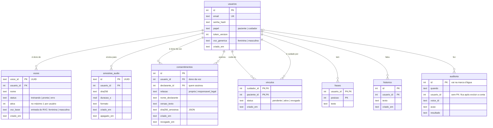

# Banco de dados e armazenamento (Fase 6)

Material para as seções de arquitetura, segurança e privacidade do relatório.

## Onde fica cada dado

| O quê | Onde | Formato |
|---|---|---|
| Metadados (contas, vozes, consentimentos, frases...) | `data/appvoice.db` | SQLite |
| Áudios de referência enviados | `amostras/<amostra_id>.enc` | AES-256-GCM |
| Modelos de voz treinados | `voice_models/<voice_id>/model.pth.enc` e `model.index.enc` | AES-256-GCM |
| Chave dos arquivos | variável `APPVOICE_MODEL_KEY` (ou `data/model.key` em desenvolvimento) | base64 |
| Segredo do token de login | variável `APPVOICE_SECRET` (ou `data/secret.key` em desenvolvimento) | texto |
| Áudio gerado e modelo aberto durante a conversão | pasta temporária do sistema, prefixo `appvoice_` | apagados no fim da requisição e na subida do servidor |

Regras:
- O banco guarda só metadados. Arquivos grandes ficam no disco, criptografados.
- O caminho de um arquivo sai sempre de um id (UUID gerado no servidor), nunca de algo enviado pelo cliente.
- Nenhuma dessas pastas é servida pela API.
- Só o `db.py` escreve SQL. As rotas chamam as funções dele.

SQLite foi escolhido para o protótipo porque não precisa de instalação e roda no mesmo ambiente do RVC. Em produção, a troca por PostgreSQL mexe só no `db.py`.

## Diagrama das tabelas

Todas as chaves estrangeiras usam `ON DELETE CASCADE`: excluir uma conta apaga junto as vozes, amostras, consentimentos, vínculos, frases e histórico. A `auditoria` é a exceção, explicada abaixo.

## Dicionário de dados

Classificação: **comum**, **pessoal** (identifica alguém) ou **sensível** (biométrico ou que pode revelar saúde, LGPD art. 5º, II).

| Tabela.campo | O que guarda | Classe | Proteção | Quanto tempo fica |
|---|---|---|---|---|
| usuarios.email | login | pessoal | só o próprio usuário vê | até excluir a conta |
| usuarios.senha_hash | hash argon2 da senha | pessoal | a senha nunca é gravada; não sai na exportação | até excluir a conta |
| usuarios.voz_generica | voz sintética usada quando não há voz clonada ativa | comum | — | até excluir a conta |
| usuarios.token_version | invalida tokens antigos ("sair de todos") | comum | não sai na exportação | até excluir a conta |
| vinculos.* | quem cuida de quem | pessoal | só vale depois que o paciente aprova | até revogar ou excluir uma das contas |
| vozes.voz_base | qual voz genérica o RVC converte para esta voz | comum | — | junto com a voz |
| vozes.* | dono e estado de cada modelo de voz | sensível (aponta para o modelo biométrico) | o modelo em si fica cifrado no disco | até o dono apagar a voz, revogar com exclusão ou excluir a conta |
| amostras_audio.sha256 | impressão digital do áudio enviado | sensível | o áudio em si fica cifrado no disco | o registro fica com `apagado_em` preenchido (prova do que foi autorizado); o arquivo some ao apagar |
| consentimentos.* | quem autorizou, em nome de quem, qual versão do termo, quais áudios | pessoal | exige confirmação da senha para registrar | histórico mantido; `revogado_em` marca a revogação |
| frases.texto | frases da grade do modo Olhar | sensível (pode revelar saúde) | só o próprio usuário lê | até o usuário editar ou excluir a conta |
| historico.texto | últimas 50 frases digitadas | sensível (pode revelar saúde) | só o próprio usuário lê; botão "Limpar"; só o modo Digitar grava | 50 mais recentes; até limpar ou excluir a conta |
| auditoria.* | quem fez o quê e quando, **nunca o texto** | pessoal | o usuário vê a própria atividade e o uso da voz dele | permanente |

### Por que a auditoria fica depois de excluir a conta

Todo áudio com voz clonada sai com uma marca d'água que contém o número de um registro da auditoria. Se um áudio aparecer num golpe depois que a conta foi excluída, o registro ainda mostra quando ele foi gerado e com qual voz. Para isso a auditoria fica, mas sem o e-mail: depois da exclusão sobra só o número do usuário, que não aponta para mais ninguém.

## Direitos do titular (LGPD art. 18) no app

| Direito | Como o app atende |
|---|---|
| Acesso e portabilidade | Ajustes > "Baixar meus dados" (`GET /conta/dados`, JSON) |
| Correção | Editar frases, trocar a voz em uso |
| Eliminação | Apagar um áudio, apagar uma voz, revogar com exclusão, "Excluir minha conta" (`POST /conta/excluir`, pede a senha) |
| Revogação do consentimento | Vozes > "Revogar consentimento" |
| Informação sobre o uso | Ajustes > "Ver atividade" (auditoria) |

## Limitações (para a seção de limitações)

- SQLite atende um servidor só. Com mais de um servidor, o banco precisa ir para PostgreSQL e os arquivos para um armazenamento compartilhado (tipo S3, com criptografia no servidor).
- Os arquivos ficam no disco da máquina. Hospedagens gratuitas costumam apagar o disco a cada reinício, então a publicação precisa de um disco persistente.
- Excluir a conta apaga os arquivos do disco, mas cópias de backup (se houver) precisam de uma política de retenção própria.
- O `historico` guarda texto de frases. Ele é limitado, separado da auditoria e pode ser limpo, mas ainda é dado sensível guardado no servidor.
